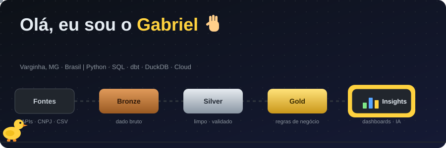

<div align="center">



<a href="https://www.linkedin.com/in/gabriel-grande/"></a>
<a href="https://github.com/GabrielKSG7?tab=repositories"></a>


</div>

---

### 🦆 Sobre mim

```python
gabriel = {
    "formacao":   "Bacharel em Ciência da Computação",
    "estudando":  "Pós em Engenharia e Arquitetura de Dados com IA (XP Educação)",
    "dia_a_dia":  ["Integrações REST/SOAP", "PL/SQL", "validação e reconciliação de dados"],
    "rumo_a":     "Data Engineering & Analytics Engineering",
    "curto":      ["pipelines Medallion", "dbt + DuckDB", "dados públicos brasileiros"],
}
```

### 🛠️ Stack

<p align="center">
  
</p>

<p align="center">
  
  
  
  
  
  
  
  
</p>

### 🚀 Projetos em destaque

> Clique em cada projeto para abrir os detalhes 👇

<details>
<summary><b>📡 Radar B2B</b> — leads B2B a partir da base pública de CNPJ, com CDC e enriquecimento por LLM</summary>
<br>

Pipeline em arquitetura Medallion que ingere dados governamentais, detecta mudanças (CDC) e enriquece oportunidades com LLMs (Gemini/OpenAI).

`Python` `DuckDB` `dbt` `Parquet` `LLMs` · 🔗 [repositório](https://github.com/GabrielKSG7/Radar-B2B) · 🎓 [versão projeto aplicado](https://github.com/GabrielKSG7/radar-b2b-projeto-aplicado)
</details>

<details>
<summary><b>🎌 MAL Analytics</b> — pipeline ponta a ponta sobre dados do MyAnimeList</summary>
<br>

Ingestão, transformações com dbt + DuckDB, sistema de recomendação e dashboard em Streamlit.

`Python` `dbt` `DuckDB` `Streamlit` · 🔗 [repositório](https://github.com/GabrielKSG7/MAL-ANALYTICS)
</details>

<details>
<summary><b>🏦 Tesouro Direto Pipeline</b> — Medallion com Kafka Connect, S3 e PySpark</summary>
<br>

Camadas Bronze/Silver/Gold sobre dados do Tesouro Direto usando PostgreSQL, Kafka Connect, AWS S3 e PySpark.

`PostgreSQL` `Kafka` `AWS S3` `PySpark` · 🔗 [repositório](https://github.com/GabrielKSG7/data-engineering-pipeline)
</details>

<details>
<summary><b>🛒 Arquitetura NoSQL para e-commerce</b> — MongoDB com sharding e replica sets</summary>
<br>

Laboratório executável de alta escala no MongoDB 7.0, com modelagem orientada a agregados e validação de schema.

`MongoDB` `JavaScript` · 🔗 [repositório](https://github.com/GabrielKSG7/arquitetura-dados-nosql-ecommerce)
</details>

<details>
<summary><b>🕹️ LOKGAM</b> — observatório de ports de jogos de console jogáveis no navegador</summary>
<br>

Catálogo curado com dados append-only em JSON/JSONL e validação por JSON Schema.

`Python` `JSON Schema` · 🔗 [repositório](https://github.com/GabrielKSG7/LOKGAM)
</details>

### 🐍 A cobrinha comendo meus commits

<p align="center">
  <picture>
    <source media="(prefers-color-scheme: dark)" srcset="https://raw.githubusercontent.com/GabrielKSG7/GabrielKSG7/output/github-snake-dark.svg"/>
    <source media="(prefers-color-scheme: light)" srcset="https://raw.githubusercontent.com/GabrielKSG7/GabrielKSG7/output/github-snake.svg"/>
    
  </picture>
</p>

<div align="center">
<sub>Bronze → Silver → Gold, um commit de cada vez. 🦆</sub>
</div>
